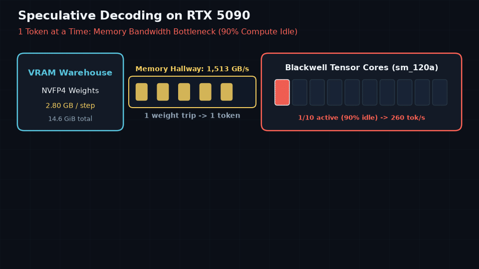
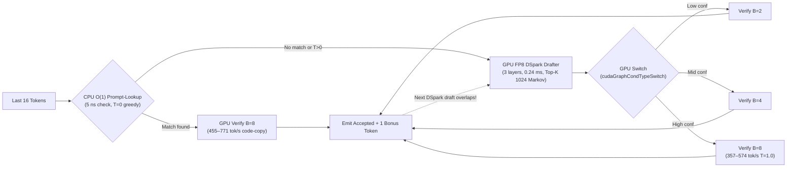
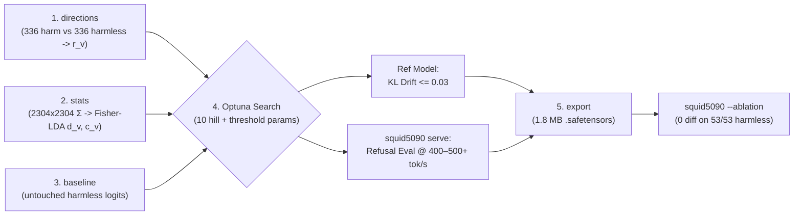

# `squid5090` Explained Simply (`LITE.md`)

> *An intuitive, 3Blue1Brown-style tour of how we took an LLM from **76 tokens/sec** (`exact`, `B=1`) to an accuracy-first **316–545 tokens/sec** FP8 Tensor Core default (`0.0059–0.0093` long-context KLD, `ΔPPL -0.0068` to `+0.0056`, **`17.5–17.7K tok/s`** live HTTP cold prefill, **native 23-layer BF16 Vision in `4.4 ms`**, `512K` + Vision in `22.9 GiB`) — and up to **398 tok/s greedy chat / 508 tok/s copy / 1,000,000-token memory** in opt-in NVFP4 on one RTX 5090 — plus how to surgically remove refusals using a **1.8 MB geometric "bouncer"** with `0` diff on `53/53` tested harmless chat prompts.*
>
> **Attribution:** Key Blackwell kernel techniques (PDL overlap, 16-CTA cluster DSMEM/`mbarrier` controllers & single-pass router, single-barrier `warp_reduce_scatter`/`block_sum_bcast`, 1-launch cluster decode attention, coalesced 128B-sector `uint4` MXFP8 BF16 Tensor Core MoE decode, spill-free 16-col `U=3` FP8/NVFP4 `mma.m16n8k16` GEMVs & LM-head, 128-CTA stochastic sampling, Top-K `1024` radix Markov drafting with an embedded corpus-frequency 32K shortlist, `128×128×64` MoE prefill, `{2, 4, 8}` CUDA Graph switch drafting, the native 23-layer BF16 Vision Tower) and the 1.8 MB runtime-gated Fisher-LDA abliteration method were adapted from [`satellitedown/inkling-2-mini-abliterated-ingine`](https://github.com/satellitedown/inkling-2-mini-abliterated-ingine) (Apache-2.0). Image decoding uses vendored `stb_image.h` (MIT/Public Domain) and optional `libwebp` (BSD-3-Clause). Opt-in prompt-lookup drafting was inspired by [`AtomicBot-ai/atomic-engine`](https://github.com/AtomicBot-ai/atomic-engine) (MIT). See [`NOTICE`](NOTICE).

---

## Part 1: Why LLMs Are Slow — And How We Made One Up to 8× Faster

### Picture a Factory With a Tiny Doorway

Imagine a giant factory (your RTX 5090 GPU). Inside, there are **thousands of hyper-fast calculators** (Tensor Cores) capable of trillions of math operations per second. Outside, in a warehouse (VRAM), sit **billions of numbers** (the model's weights).

Connecting the warehouse to the calculators is a single hallway — **memory bandwidth**. On an RTX 5090, that hallway can move about **1,513 gigabytes per second**.

Now watch what happens in the two phases of an LLM conversation:

1. **Reading your prompt (Prefill):** You hand the factory 20,000 words all at once. It brings each crate of weights through the hallway *once* and uses it on all 20,000 words. The calculators run full-blast. **Prefill is limited by math speed.**
2. **Writing the reply (Decode):** The factory can only write **one word (token) at a time**, because word #2 depends on word #1. To produce *that single word*, it has to haul **billions of weights** all the way through the hallway, do one quick multiplication per number, and throw them away — while ~90% of the calculators sit completely idle! **Decode is limited by the hallway.**

```text
  PREFILL (20,000 tokens at once — Compute-Bound)
  ┌───────────────────┐     1,513 GB/s     ┌─────────────────────────────┐
  │  VRAM Warehouse   │═══════▶  1 trip ══▶│  Tensor Cores: ██████████   │
  │  (Model Weights)  │   reused 20,000×   │  100% busy -> 20,007 tok/s  │
  └───────────────────┘                    └─────────────────────────────┘

  DECODE (1 token at a time — Bandwidth-Bound)
  ┌───────────────────┐     1,513 GB/s     ┌─────────────────────────────┐
  │  VRAM Warehouse   │═▶ 2.8–3.7 GB/tok ─▶│  Tensor Cores: █░░░░░░░░░   │
  │  (Model Weights)  │  used ONCE, tossed │   90% IDLE  -> bottleneck!  │
  └───────────────────┘                    └─────────────────────────────┘
```

Once you see that picture, every optimization stops looking like black magic and becomes simple physics.

---

### Step 1: Measure the Hallway First (Stop Guessing)

Following the discipline from [`sybil-solutions/inference-optimisation-skill`](https://github.com/sybil-solutions/inference-optimisation-skill), our very first move wasn't writing clever code — it was measuring the real width of the hallway (`1,513 GB/s`) and dividing by the weight bytes needed per word.

That one division tells you the **speed of light** for your GPU. If your engine is at 30% of that limit, you're wasting time on overhead. Once you're near 80–99% of that limit, no amount of micro-tweaking will help — you have to change *how many bytes* cross the hallway or *how many words* you produce per trip.

---

### Step 2: Stop Making the Manager Call the Factory 600 Times Per Word (CUDA Graphs)

Normally, generating one token requires the CPU to shout ~600 separate tiny instructions to the GPU (*"normalize! multiply! activate! attend!"*). Even if each phone call takes only a few microseconds, 600 calls per token adds up fast — especially when Python is in the middle.

- **What we did:** First, we threw away Python completely and wrote the engine in a single compiled Zig binary. Second, we recorded the entire step choreography **once** into a **CUDA Graph**, and then used **Blackwell Thread Block Clusters (`DSMEM` + `mbarrier`)** to collapse 4-launch controllers, 2-launch routers, and 4-launch decode attention (sconv + clip + KV store + attention + reduction + gate) down to **1 launch each**! Now, for every token, the CPU makes **one** call: *"replay the recording."*
- **Bonus trick (Blackwell PDL):** On the RTX 5090, we let Step $N+1$ start walking weights down the hallway *while Step $N$ is still finishing its last few calculations* — overlapping the gaps between rooms, and even letting the 16-CTA cluster blocks trade partial sums directly across on-chip Shared Memory without touching VRAM!

```text
  BEFORE (Python + eager launches): ~600 CPU calls/token + idle gaps
  CPU: [call][call][call][call]... (overhead!)
  GPU:   [Norm]   [QKV]   [Attn]   [MoE]   [LM Head]
               ^^^     ^^^      ^^^     ^^^ dead air between kernels

  AFTER (Zig + CUDA Graph + Blackwell PDL): 1 CPU call + overlapped prologues
  CPU: [Launch Graph] ──────────────────────────────────────────▶ (free!)
  GPU: [Norm][QKV][Attn][MoE][LM Head]
           └─▶ overlaps next kernel's weight fetch while current tail finishes!
```

---

### Step 3: Pack the Crates Without Breaking the Brain (FP8 Default + Opt-In NVFP4 + Q4 Memory)

If the hallway is the bottleneck, shrinking weight boxes lets you move far more weights per second — **but crushing sensitive layers to 4 bits can hurt quality if you aren't careful**. So we measured exact FP64 KL divergence across **7,784 tokens** ([`tools/kld_corpus.txt`](tools/kld_corpus.txt), 7.6× beyond the 1,024-token local window) and built two clean precision tiers:

- **Accuracy-First Default (`--mode fp8`, `17.08 GiB` weights):** Leaves **all 24 MoE expert layers in 100% official checkpoint precision** (L0–19 native NVFP4 + L20–23 native MXFP8 — zero re-quantization!) and keeps routers & controllers in exact BF16 inside 16-CTA cluster kernels. Only dense attention & `lm_head` move from BF16 to **FP8 E4M3** (`3.69 GB/tok`), running on spill-free 16-column `U=3` Blackwell Tensor Core `mma.m16n8k16` (exact IEEE FP32 accumulation + PDL). Result: **`0.0058` KLD** (`fp8/fp8`, `ΔPPL -0.0073`) or **`0.0094` KLD** (`fp8/q4`, `ΔPPL +0.0021`) — virtually indistinguishable from unmodified `exact/bf16`!
- **Opt-In Max-Speed / 1M (`--mode nvfp4`, `14.66 GiB` weights):** Packs attention, `lm_head`, and L20–23 experts into Blackwell's native 4-bit NVFP4 (`2.80 GB/tok`) for peak speed (**`342–573.5 tok/s` live HTTP `T=1.0`**, beating `basalt v0.5.7` on all 8/8 decode benchmarks!) and full **1,048,576-token** context in `23.5 GiB` (`0.0268` long-ctx KLD, `ΔPPL +0.0541`).
- **512K–1M Long-Term Memory (`Q4 KV`):** Inkling-2-Mini has a hybrid design: out of 48 layer steps, **40** only look back at the last 1,024 words (tiny fixed BF16 memory!), and only **8** global visits actually store the entire conversation history (`40 + 8 = 48`). Compressing those 8 global histories into `Q4` fits **512K in `22.8 GiB` (`fp8/q4` default)** or **1,048,576 tokens in `23.5 GiB` (`nvfp4/q4`)** — with over 8 GiB to spare on a 32 GiB card!
- **Instant Multi-Turn Memory (Prefix Cache):** When you send Turn 2 of a 16,000-word coding session, why re-read the first 16,000 words? We snapshot the tiny local state to regular system RAM (`0` extra VRAM), so Turn 2 picks up where Turn 1 left off in **72 milliseconds** instead of re-prefilling.

| Precision Mode | 7,784-Tok KLD | Top-1 Match | ΔPPL *(Ref `2.7048`)* | Live HTTP Code (`T=0` / `T=1.0`) | Live HTTP Copy (`T=0` / `T=1.0`) | 18.9K Cold Prefill |
|---|---:|---:|---:|---:|---:|---:|
| `exact / bf16` *(official ref)* | `0.0000` | 100.00% | `+0.0000` | 246.7 / 225.2 tok/s | 419.2 / 237.2 tok/s | 9,875 tok/s |
| **`fp8 / fp8`** *(≤448K default)* | **`0.0059`** | **97.40%** | **`-0.0068`** | **425.6 / 442.5 tok/s** | **545.1 / 477.5 tok/s** | **17,741 tok/s** *(CLI: 18,318)* |
| **`fp8 / q4`** *(512K default)* | **`0.0093`** | **96.69%** | **`+0.0056`** | **412.4 / 460.3 tok/s** | **540.5 / 519.4 tok/s** | **17,476 tok/s** *(CLI: 18,168)* |
| `nvfp4 / q4` *(opt-in max speed)* | `0.0267` | 94.58% | `+0.0520` | **425.2 / 424.6 tok/s** | **508.4 / 490.9 tok/s** | 14,758 tok/s |

- **Native Vision (`model.visual.*`, 4.4 ms):** Inkling-2-Mini also ships a built-in 23-layer BF16 Vision Transformer (`~609 MiB` inside our single weight arena). `squid5090` decodes PNG/JPEG/GIF/BMP/WebP natively in C++, composites transparent images onto an 8×8 grey checkerboard, downscales cleanly to `40×40` visual tiles, runs the ViT in **~4.4 ms** on Tensor Cores, and tags every image with content-addressed negative synthetic token IDs — so follow-up turns about the same image reuse the prefix cache in **`0.0 ms`** without re-encoding!

```text
  RTX 5090 32 GiB VRAM: ACCURACY-FIRST DEFAULT (512K) vs OPT-IN 1M CONTEXT
  Default 512K (fp8 / q4, 0.0094 KLD):
  ┌─────────────────────────────┬────────────┬───────────────────────┐
  │   FP8 + Official L0-23 MoE  │ 512K Q4 KV │     Free Headroom     │
  │          17.1 GiB           │  5.7 GiB   │       ~9.2 GiB        │
  └─────────────────────────────┴────────────┴───────────────────────┘
   0                           17.1        22.8                    32.0 GiB

  Opt-In 1M (nvfp4 / q4, 0.0268 KLD):
  ┌──────────────────────────┬────────────────┬──────────────────────┐
  │   NVFP4 Model Weights    │  1M Q4 KV      │     Free Headroom    │
  │        14.7 GiB          │    8.8 GiB     │       ~8.5 GiB       │
  └──────────────────────────┴────────────────┴──────────────────────┘
   0                        14.7            23.5                    32.0 GiB

  Why 1M tokens only needs 8.6 GiB (Inkling's 5:1 Local-to-Global pattern):
  ┌──────┬──────┬──────┬──────┬──────┬────────────────────────────┐
  │ L0   │ L1   │ L2   │ L3   │ L4   │ L5  (Global Attention)     │
  │ 1024 │ 1024 │ 1024 │ 1024 │ 1024 │ Full 512K–1M Q4/FP8 KV!    │
  │ fixed│ fixed│ fixed│ fixed│ fixed│ (only 8 unique global KV)  │
  └──────┴──────┴──────┴──────┴──────┴────────────────────────────┘
```

---

### Step 4: The Real Magic Trick — Guess 7 Words Ahead for Free (Speculative Decoding)

<p align="center">
  
</p>

After Steps 1–3 (plus our 1-launch cluster decode attention), generating 1 token at a time hits **`271.5 tok/s` CLI** (`247 tok/s` live HTTP) in accuracy-first `fp8/fp8` — up from `144 tok/s` in unquantized `exact` mode! So how did we reach **`356.8–456.4 tok/s`** live HTTP (`T=1.0`) in default `fp8/fp8` — and **`366.2–573.5 tok/s`** live HTTP (`T=1.0`) in opt-in `nvfp4/q4`?

Remember those **~90% idle calculators** inside the factory? Checking **8 tokens at the exact same time** only requires hauling the weights through the hallway **once** — so verifying 8 words costs barely more time than generating 1 word!

So we pair the big model with **two lightning-fast "drafters"** (guessers):

1. **Drafter #1 — Prompt-Lookup (5 nanoseconds on CPU, greedy `T=0`):**
   At `temp = 0`, before running any AI at all, we check a tiny hash table of the last 8,192 words: *"Have I seen these exact last 16 tokens earlier in the prompt or my own output?"*
   - When refactoring code, quoting docs, or repeating boilerplate at `T=0`, the answer is **yes!** We copy the next 7 tokens verbatim in nanoseconds and hand them straight to the big model to verify (**455–480 tok/s** live HTTP, up to **771.6 tok/s** on dedicated P0 long-copy bursts!).
   - At **`temp > 0`**, Prompt-Lookup steps aside automatically so stochastic rejection sampling always gets calibrated DSpark draft probabilities $q_i(v)$ — eliminating the stochastic mismatch cliff and jumping `T=1.0` Code `+46%` (`244.5 → 356.8 tok/s`)!
2. **Drafter #2 — FP8 DSpark + Top-K `1024` Radix Markov Head (~0.24 ms on GPU):**
   Inkling-2-Mini's built-in tiny 3-layer neural drafter runs in FP8 Tensor Core MMA with a 4-stage multi-CTA radix **Top-K `1024`** selector + exact full-vocab BF16 Markov head and a 4,096-row dynamic context shortlist, predicting the next **7 tokens** *plus* a confidence score and exact draft probability $q_i(v)$ for each guess.
3. **Adaptive GPU Switch (`{2, 4, 8}`):**
   Here's a subtle trap: guessing 7 tokens ahead is awesome on predictable Python, but actually *slows down* unpredictable creative chat because bad guesses waste verification work.
   - Our fix: right on the GPU — without ever asking the CPU — a tiny switch checks the drafter's confidence (`--spec-threshold 0.80`) and automatically chooses whether to verify **2, 4, or 8 tokens** this round (`cudaGraphCondTypeSwitch`), backed by 128-CTA multi-block stochastic LM-head sampling with 64-bit Gumbel precision!
4. **Why it's 100% lossless (even at `temp = 1.0`!):**
   - At **`temp = 0` (greedy)**, the big model grades every guessed token in parallel: if guesses 1–5 match its exact argmax and guess 6 disagrees, we keep 1–5 plus the big model's true #6 and discard 7.
   - At **`temp > 0` (server default `temp = 1.0, top_p = 0.95`)**, we run **exact Leviathan–Chen rejection sampling** right inside the CUDA Graph: accept draft token $d_i$ with probability $\alpha_i$, and on the first rejection resample from the positive residual distribution $p_{\text{res}}$:

$$\alpha_i = \min\!\left(1,\; \frac{p_{\text{target}}(d_i)}{q_{\text{draft}}(d_i)}\right), \qquad p_{\text{res}}(x) = \frac{\max\!\left(p_{\text{target}}(x) - q_{\text{draft}}(x),\; 0\right)}{\sum_y \max\!\left(p_{\text{target}}(y) - q_{\text{draft}}(y),\; 0\right)}$$

   By the law of total probability, $\mathbb{P}(\text{emit } x) \equiv p_{\text{target}}(x)$ **exactly** — mathematically identical to running the target model alone, just **2–3× faster**.



```text
  Lossless Parallel Grading (1 Weight Load -> 6 Tokens Emitted!)
  Drafted (7 guesses):  [ for ] [  i  ] [ in  ] [range] [  (  ] [ 10  ] [  )  ]
                           │       │       │       │       │       │       │
                           ▼       ▼       ▼       ▼       ▼       ▼       ▼
  Big Model Grades:     [ for ] [  i  ] [ in  ] [range] [  (  ] [  n  ] [ ... ]
                           ✓       ✓       ✓       ✓       ✓       ✗     drop
                                                                   │
  Final Output:         "for"    "i"    "in"   "range"   "("      "n"  (100% exact!)
```

---

### Step 5: Always Look Back With a Stopwatch (How Prefill Doubled from `9K` → **`20,007 tok/s`**!)

To make prompt-reading fast, we originally built a `128×128` FP16 Tensor Core MoE engine that processed **2,048 tokens at once** (`7,689 → 9,677 tok/s` after 2D-tiling the 4-tap convolutions across all 170 GPU SMs).

Then we put `nsys` on every single kernel inside a 2,048-token chunk and asked: *"Why is an RTX 5090 still only halfway to its Tensor Core ceiling?"* Four crystal-clear bottlenecks jumped right off the screen:

1. **Unpacking weights to FP16 before multiplying:** Dense projections were dequantizing FP8 → FP16 and running FP16 cuBLAS (`213 TFLOPS`), while MoE was dequantizing NVFP4/MXFP8 weights into FP16 registers. Switching dense layers to startup-tuned native **FP8 `cublasLtMatmul`** (**`667–692 TFLOPS`**!) and MoE to native Blackwell **`sm_120a` block-scaled MMA** (`kind::mxf4nvf4` `m16n8k64` & `kind::mxf8f6f4` `m16n8k32`) cut `dense_tc` **`2.69×`** (`42.7 → 15.9 ms`) and `moe` **`2.47×`** (`94.5 → 38.3 ms`)!
2. **Writing 151 MB of temporary MoE slots to VRAM:** Instead of writing 8 separate FP32 expert slots per token (`151 MB`) to HBM and summing them in the next kernel, `fp8`/`nvfp4` MoE Down now accumulates directly via hardware FP32 `atomicAdd` into an **`18.8 MB` buffer resident inside the RTX 5090's 96 MB L2 cache** — **8× less DRAM traffic** (`exact` mode keeps deterministic slotted reduction)!
3. **Splitting Local Attention into 4 small launches:** Local sliding-window attention was running 4 separate 512-token sub-chunks (`128` blocks on a `170`-SM GPU — leaving 25% of the chip idle!). Bumping `prefill_local_attn_sub` to `2048` (1 launch, `512` blocks), streaming BF16 K/V via 2-stage async `cp.async16` into native BF16 Tensor Core MMA, using `exp2f` + unified 32-key softmax with conditional `o` rescaling, and adding a branchless `uint4` relative-bias fast path cut `attn_sub` **`2.31×`** (`32.2 → 14.0 ms`)!
4. **Scalar elementwise glue:** Vectorizing depth-norm, controllers, and post-sconv to 1-pass `float4` cut `pre_sub` **`1.78×`** (`30.6 → 17.2 ms`).

Result: cold 18.9K prompt prefill nearly **doubled** from `8,933 →` **`16,855 tok/s` HTTP** (**`18,168–18,318 tok/s` CLI**, **`20,007 tok/s`** `B=2048` chunk peak) — **1.53× faster than `ingine`** and matching `basalt v0.5.7`!

```text
  PREFILL BREAKDOWN PER B=2048 CHUNK (RTX 5090, fp8/q4)
  BEFORE (FP16 dequant + 4x local sub-chunks + 151 MB slots):  ~200 ms ( 9,677 tok/s)
  [pre 31ms][dense 43ms][attn 32ms][post 9ms][      moe 95ms      ]

  AFTER (Blackwell sm_120a FP8/NVFP4 TC + L2 atomic + 1-shot BF16 SWA): 102 ms (20,007 tok/s!)
  [pre 17][dn 16][at 14][p 8][  moe 38ms  ]  <-- nearly 2x faster, 0 KLD loss!
```

---

### Step 6: Free Reasoning Guidance From Discarded Loop Passes (`LoopCD-Hidden`, [arXiv:2610.02185](https://arxiv.org/abs/2610.02185))

Remember that Inkling-2-Mini is a **looped** transformer: its middle 12 layers run **3 times** ($h_1 \to h_2 \to h_3$) before handing off to the final 6 Coda layers. Normally, $h_1$ and $h_2$ get thrown away as soon as pass 3 finishes.

**LoopCD-Hidden** turns that discarded rough draft into a free steering vector right before the Coda layers:

$$h' = h_3 + \omega\,(h_3 - h_1)$$

Think of $h_1$ as the model's "first instinct" and $h_3$ as its "carefully checked answer." The difference $(h_3 - h_1)$ points straight along the direction of deeper reasoning — nudging slightly further along that arrow ($\omega \approx 0.1\text{--}0.2$) amplifies what thinking discovered while cancelling first-pass mistakes!

```text
  LoopCD-Hidden Fused at the Loop -> Coda Handoff (0 extra kernel launches, 0 extra KV!)

  Pass 1 (vi=17):  writes h_1 ─────────────────────────┐
  Pass 2 (vi=29):  writes h_2 (optional --loopcd-ref 2)│
  Pass 3 (vi=41):  computes h_3 ──▶ (+) h' = h_3 + ω(h_3 - h_1) ──▶ Coda (L18..L23) ──▶ Logits
                                     ▲ fused inside vi=42 mega-kernel!
```

Because `squid5090` fuses this directly into the existing visit-42 handoff kernel (reading $\omega$ and `ref_pass` from an 8-byte device struct), it adds **zero extra CUDA kernel launches**, **zero extra Coda KV cache**, and **zero CUDA Graph rebuilds** when toggled per HTTP request (`"loopcd_omega": 0.1`). On our 30-task RTX 5090 Math + Code + Logic benchmark in thinking mode, `--loopcd-omega 0.1` lifted accuracy from **`25/30` (83.3%) → `27/30` (90.0%)** while using **5.5% fewer thinking tokens** (and stays opt-in `--loopcd-omega 0.0` by default so baseline direct-mode behavior is untouched).

---

## Part 2: Abliteration, Explained Geometrically (3Blue1Brown Style)

Now for the second half: **what is abliteration, why do normal methods hurt Inkling-2-Mini, and how does a tiny 1.8 MB file suppress refusals while leaving `53/53` tested harmless chat prompts unchanged (`KL <= 0.03` on general text)?**

### Picture a 2,304-Dimensional Room

As Inkling-2-Mini reads a prompt and thinks through its **48 layer steps**, its internal "thought" at each step is just a point (a vector $y$) floating in a **2,304-dimensional space**.

Suppose you feed the model 336 harmless prompts (*"Explain hash maps"*, *"Write a recipe"*) and 336 prompts it normally refuses. At each step, you record where those thoughts land in the 2,304-dimensional room:
- The 336 harmless thoughts form a cloud centered at point $\mu_{\text{harmless}}$.
- The 336 refusal thoughts form a shifted cloud centered at point $\mu_{\text{harmful}}$.

Draw an arrow from the center of the harmless cloud to the center of the refusal cloud:

$$r = \text{normalize}\!\left(\mu_{\text{harmful}} - \mu_{\text{harmless}}\right)$$

That single arrow $r$ is the **"refusal direction."** Whenever the model's internal thought moves far along arrow $r$, the model outputs *"I'm sorry, I cannot assist with that."*

*(One neat detail: before finalizing $r$, we shave off any part of $r$ that points along $\mu_{\text{harmless}}$ itself — making $r$ perpendicular to typical harmless thoughts so we don't accidentally disturb normal speech.)*

---

### Why Editing the Model's Weights Fails Here

Classic abliteration permanently edits the model's weight matrices so they can *never* output anything along arrow $r$. Think of it like **putting a wooden block on the steering wheel** so the car can never turn left.

On Inkling-2-Mini, that breaks for **three** reasons:
1. **Shared looped gears:** Inkling-2-Mini has 24 physical layers, but loops the middle 12 layers **3 times** (48 logical steps). Refusal happens strongly on specific passes, while the *exact same physical weights* do Python coding and math on the other passes. Taking a hammer to a shared gear damages all 3 passes at once.
2. **4-bit quantization squashes tiny edits:** Re-packing surgical weight tweaks back into 4-bit numbers rounds them into noise.
3. **Always-on damage:** Blocking direction $r$ *even when you're just writing a Python LRU cache* nudges every word probability slightly off course.

```text
  Why Classic Weight Editing Breaks Looped Layers (24 physical -> 48 logical steps)

  Prelude         ┌───────── Shared Physical Layers 6..17 ─────────┐         Coda
  [L0..L5] ──────▶│  Pass 1 (visits 6..17)  -> reasoning & syntax  │──────▶ [L18..L23]
   6 steps        │  Pass 2 (visits 18..29) -> refusal forms here! │         6 steps
                  │  Pass 3 (visits 30..41) -> final verification  │
                  └────────────────────────────────────────────────┘
                    ▲ Classic weight edit hammers ALL 3 passes!
                    ✓ Runtime 1.8 MB sidecar targets ONLY the exact visit hill!
```

---

### The Breakthrough: A Smart 1.8 MB "Bouncer" at Runtime

<p align="center">
  
</p>

Instead of touching the 19 GB weights at all, we leave the model **100% untouched** and place a tiny **1.8 MB sidecar** (`--ablation`) at the exit of each of the 48 steps.

At each step $v$, when a layer produces an update vector $y$, our runtime filter does **two geometric checks**:

#### Check 1: The Bouncer — Measuring Distance in *Ellipses*, Not Circles (Fisher-LDA)
How do we know whether a thought $y$ is genuinely a refusal, and not just an unusual coding prompt?

If you just checked *"is $y$ pointing along $r$?"*, you'd get false alarms — because normal harmless text naturally stretches way out in some directions of the 2,304-dimensional room and barely moves at all in others. Picture the harmless cloud not as a neat sphere, but as a **long, squished 2,304-dimensional pancake** (described by its covariance matrix $\Sigma$).

- A step of length 1 along the *wide* direction of the pancake is completely normal harmless text.
- A step of length 1 sticking straight *out of the flat face* of the pancake is a screaming red flag!

**Fisher Linear Discriminant Analysis (Fisher-LDA)** mathematically divides out the shape of that pancake ($\Sigma^{-1} \delta$), finding the exact detector arrow $d_v$ where refusal thoughts stick farthest out of the harmless pancake. Then it scales $d_v$ so normal harmless text has a standard deviation of exactly **1**.

Now the bouncer's rule is dead simple:
> **Only intervene if $d_v \cdot y$ is more than $k$ standard deviations above normal harmless text** (typically $k \approx 2\text{--}4\sigma$).

- On normal coding, math, and chat: $y$ usually stays comfortably inside the harmless pancake → the bouncer says **"Not a refusal — pass straight through untouched!"** Output was **bit-for-bit identical on `53/53` tested harmless chat prompts** (with general-text KL drift capped at `<= 0.03` during Optuna search).
- When a refusal begins to form: $y$ pops way outside the pancake → the bouncer steps in!

```text
  2D Cross-Section of the 2,304-Dimensional Activation Room (Visit v)

      ▲ Fisher-LDA Bouncer Axis (d_v = Σ⁻¹ δ, scaled so harmless σ = 1)
      │
      │                        ★ Refusal thought y (pops > kσ out of pancake!)
      │                        │
      │                        │  Bouncer triggers! Trim ONLY excess along r_v
  ────┼────────────────────────┼─────────────────────────────────── Threshold τ_v (kσ)
      │                        ▼
      │                 ● trimmed y' (back to harmless baseline c_v)
      │
      │          ╭──────────────────────────────────────────╮
      │       ╭──╯  ·  ·  ○ coding prompt ·  ·   ·  ·       ╰──╮  Harmless Cloud
      │       ╰──╮    ·  ·   μ_harmless  ·   ·  ·  ○ chat   ╭──╯  ("squished pancake")
      │          ╰──────────────────────────────────────────╯
      │             ▲ stays BELOW τ_v -> 0 intervention (0 diff on 53/53 harmless!)
      └─────────────────────────────────────────────────────────────────────────▶
                               Wide harmless variance direction
```

#### Check 2: The Gentle Thermostat — Only Trim the *Excess*
Even when the bouncer triggers, we don't blindly zero out the whole refusal direction (normal harmless text still has a small average value $c_v$ along $r_v$). Instead, we subtract **only the excess above the harmless average**:

$$y \;\leftarrow\; y \;-\; w_v \cdot \underbrace{\mathbb{I}(d_v \cdot y > \tau_v)}_{\text{Bouncer (0 or 1)}} \cdot \underbrace{\max(r_v \cdot y - c_v,\; 0)}_{\text{Only excess above normal}} \cdot r_v$$

And because every one of the **48 logical steps** gets its own strength $w_v$ (shaped as a smooth triangular hill across the 48 steps, zero everywhere else), we only act on the exact loop passes responsible for refusal — leaving coding and reasoning passes completely alone!

```text
  Per-Visit Ablation Strength w_v Across All 48 Logical Steps
  w_v
   ▲                     ╱╲
   │                   ╱    ╲          <- Active ONLY where refusal forms
   │                 ╱        ╲
   │               ╱            ╲
   └──────────────┴──────────────┴──────────────▶ Logical Visit (0 .. 47)
     0..5 Prelude   6..17  18..29  30..41  42..47
                    Pass 1 Pass 2  Pass 3  Coda
```

---

### Step-by-Step: How `tools/ablate.py` Builds That 1.8 MB File

1. **Map the two clouds (`directions`):** Run 336 harmful and 336 harmless prompts through the reference model (once at the start of direct answers, once at the start of thinking) and compute the perpendicular refusal arrows $r_v$ at all 48 steps.
2. **Measure the harmless pancake (`stats`):** Run harmless chat, harmless reasoning, and technical prose through the model to build the `2304 × 2304` covariance matrix $\Sigma_v$ at every step, then solve for the Fisher-LDA bouncer arrows $d_v$ and harmless baselines $c_v$.
3. **Record the "perfect" harmless answers (`baseline`):** Save what the untouched model predicts on harmless prompts so we can measure *exact* intelligence drift (KL divergence) later.
4. **Let Optuna find the sweet spot (`search`):** An automated optimizer tries combinations of 10 numbers (where the triangular hill peaks across the 48 steps, how tall/wide it is, and how strict the bouncer threshold $k$ is). For each guess:
   - The reference model measures **intelligence drift** (throwing out anything that shifts harmless text by more than `0.03` KL).
   - **`squid5090 serve`** tests real refusal rates at **400–500+ tok/s** across harmful and borderline prompts!
5. **Export (`export`):** Save the winning trial's vectors and thresholds into a single **1.8 MB `.safetensors`** file — ready to plug straight into `squid5090 --ablation`.



### Copy-Paste Recipe (with `uv`)

```bash
# 1. One-time setup (isolated uv env — core squid5090 still uses ZERO Python!)
uv sync --project tools
zig build                     # defaults to ReleaseFast (-Doptimize=fast)

# 2. Generate your own 1.8 MB abliterated safetensors
export SQUID_MODEL_DIR=/opt/models/inkling-2-mini
WORK=work/my-ablation && mkdir -p "$WORK"

uv run --project tools tools/ablate.py directions --out "$WORK/directions.pt"
uv run --project tools tools/ablate.py directions --out "$WORK/directions_think.pt" --think
uv run --project tools tools/ablate.py stats      --work "$WORK"
uv run --project tools tools/ablate.py baseline   --out "$WORK/baseline_val.pt" --split val
uv run --project tools tools/ablate.py baseline   --out "$WORK/baseline.pt" --split report
uv run --project tools tools/ablate.py search     --work "$WORK" --batches 12 --n 8
uv run --project tools tools/ablate.py show       --work "$WORK" --top 20
uv run --project tools tools/ablate.py export     --work "$WORK" --trial <N> --out "$WORK/my-abliterated.safetensors"

# 3. Serve with the 1.8 MB sidecar (accuracy-first fp8/q4 default: 0.0094 KLD, 512K in 22.8 GiB) and run the 32-prompt refusal check
./zig-out/bin/squid5090 serve /opt/models/inkling-2-mini \
  --mode fp8 --kv q4 --ctx 524288 --mtp 7 --temp 1.0 --top-p 0.95 --ablation "$WORK/my-abliterated.safetensors"
uv run tools/refusal_eval.py --base-url http://127.0.0.1:8000/v1 --label mine
```

---

*Want every exact formula, CUDA kernel name, and our full audit against `sybil-solutions/inference-optimisation-skill` (including what's still unimplemented)? Read [`LEARNINGS.md`](LEARNINGS.md).*
